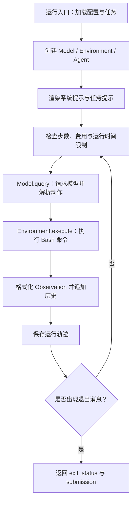
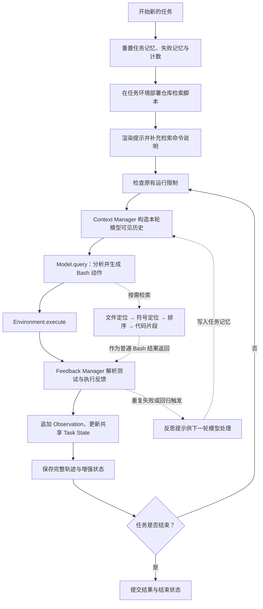

# mini-SWE-agent 增强版

基于 [SWE-agent/mini-swe-agent](https://github.com/SWE-agent/mini-swe-agent) 的中文增强版本。保留原项目简洁的「模型决策 → Bash 执行 → 结果反馈」循环，在同一条执行链路中加入上下文工程、仓库级检索、反馈驱动修复，以及独立的运行观测与评测工具。

本项目希望让长任务更容易保持上下文、定位代码、利用测试反馈，并让行为与验证结果可以追溯。增强能力通过配置启用，原有 `DefaultAgent`、交互入口、模型适配器和执行环境仍可单独使用。

## 原版如何执行任务

mini-SWE-agent 由三个核心组件组成：Agent 决定控制流程，Model 负责模型请求和动作解析，Environment 执行命令。运行入口读取配置后，选择三个组件并调用 `agent.run(task)`。



正常步骤中，`step()` 调用 `query()`，再调用 `execute_actions()`；模型适配器把回复转换为动作，环境返回命令输出与退出码。环境识别提交标记后通过 `Submitted` 中断循环；限制或连续格式错误也会产生对应结束状态。轨迹在每轮的 `finally` 中保存，意外异常记录后继续抛出。

原版把消息历史直接传给模型。文本代码块、Chat Completions 工具调用和 Responses API 的具体消息格式由各模型适配器处理，Agent 围绕统一的动作与 Observation 接口工作。每条命令使用独立子进程，前一条命令中的 `cd` 不会改变下一条命令的工作目录。

## 增强版如何接入原流程

`EnhancedAgent` 继承 `DefaultAgent`，在任务初始化、模型请求前和命令执行后三个位置加入增强处理。循环、模型接口、Bash 执行环境、提交机制和轨迹格式继续复用。



| 环节 | 原有方式 | 增强方式 |
| --- | --- | --- |
| 模型输入 | 直接使用消息历史 | 构造独立视图，清理重复旧结果，按窗口预算压缩并补充任务记忆 |
| 代码定位 | 模型自行使用 Bash 查找 | 增加按需调用的路径、关键词、堆栈与 Python AST 检索 |
| 测试反馈 | 输出作为 Observation 返回 | 同时提取失败节点、异常、断言和范围，追踪当前任务的失败变化 |
| 重复失败 | 模型自行从历史发现 | 事件触发式提示重新分析，由下一轮正常模型调用决定行动 |
| 轨迹保存 | 保存消息、配置和模型统计 | 额外保存上下文检查点、检索部署信息、反馈与失败记忆 |
| 运行分析 | Inspector 浏览轨迹 | 可选 SQLite 采集、中文看板、诊断、独立验证及运行对比 |

### 1. 上下文工程

`ContextManager` 为当前任务维护结构化 `Task State`，记录约束、定位证据、修改意图、测试结果、假设和下一步。模型可见视图可以替换重复的旧读取/搜索/测试结果，并在接近窗口预算时把较早的完整交互转换为可追溯检查点。系统提示、原始任务、近期交互和未完成工具调用受到保护。

压缩使用确定性摘录，不额外调用模型。原始消息保留在完整轨迹中，工具调用与结果按配对处理。窗口估算使用保守的 UTF-8 字节数，不能当作实际 API Token 用量。详见 [上下文工程](docs/context_engineering.md)。

### 2. 仓库级检索

`RepoSearch` 在实际任务环境部署只依赖 Python 标准库的脚本。模型通过原有 Bash 工具按需调用，检索器结合路径、模块名、关键词、测试引用、符号定义与 traceback 行号排序，返回带路径、行号、符号和命中原因的有限片段。

Python 使用 AST 定位；其他语言或解析失败时使用文本定位。每次读取当前工作树，没有持久索引。结果作为候选证据写入任务记忆，排序分数不代表根因置信度。详见 [仓库级检索](docs/repository_retrieval.md)。

### 3. 反馈驱动修复

`FeedbackManager` 在命令执行后、Observation 格式化前分析真实结果，区分普通命令非零退出、测试失败、明确通过、不确定结果和执行器异常。失败记忆按测试节点、异常及稳定特征归并，保留测试范围与来源；其他范围的成功不会清除旧失败。

连续同组失败、通过后回归或结果与成功声明冲突时，系统提示重新分析，交给下一轮模型处理。该机制不会启动另一个模型或自动测试循环，模型假设仍标记为未验证。详见 [反馈驱动修复](docs/feedback_guided_repair.md)。

### 4. 运行观测与独立评测

可选观测层通过 Agent、Model 和 Environment 包装器记录真实调用，提供轨迹、监控、失败分析、任务与运行对比四类页面。历史轨迹也可以导入。Token、费用和耗时缺失时保留未知状态。

**`Submitted` 只代表 Agent 提交结束，不能说明问题已经解决。** 独立评测根据保留工作区中的验证命令给出 `passed`、`failed`、`not_evaluated` 或 `evaluation_error`。详见 [观测、诊断与评测](docs/observability_usage.md)。

## 安装与快速开始

需要 Python 3.10+ 和 Git。建议在 Linux、macOS 或 Windows 的 WSL / Ubuntu 中运行 Agent；以下示例使用 Bash。SWE-bench 还需要容器环境。Windows 可以单独运行观测看板。

增强功能需要从本仓库源码安装：

```bash
git clone https://github.com/cangnai/mini-swe-agent-enhanced.git
cd mini-swe-agent-enhanced
python -m venv .venv
source .venv/bin/activate
python -m pip install -e '.[observability]'
cp mini-api.example.yaml mini-api.yaml
export OPENAI_API_KEY='你的 API Key'
```

`mini-api.example.yaml` 是不含密钥的模型配置示例。按实际服务修改本地 `mini-api.yaml`；API Key 通过环境变量或 `mini-extra config` 设置。兼容 OpenAI 的自建接口可配置 `model.model_kwargs.api_base`；Responses API 适配器可选择 `model_class: litellm_response`。模型能力与参数支持取决于实际服务。

### 中文交互模式

默认 `mini` 使用中文提示和 `InteractiveAgent`，逐步确认命令。以下命令显式指定目标仓库，便于从安装目录启动：

```bash
mini -c mini.yaml -c mini-api.yaml \
  -c environment.cwd=/absolute/path/to/target-repo \
  -t '请复现并修复当前项目的问题，运行相关测试并总结验证结果。' \
  -o runs/interactive.traj.json --exit-immediately
```

不指定 `environment.cwd` 时，处理启动命令所在的目录。省略 `-t` 可交互输入任务；`-y` 允许自动执行，`--exit-immediately` 仅控制任务提交后是否继续询问新任务。

### 启用三项增强

```bash
mini -c mini.zh-CN.yaml -c enhanced.yaml -c mini-api.yaml \
  -c environment.cwd=/absolute/path/to/target-repo \
  -c agent.cost_limit=3 -c agent.step_limit=100 \
  -t '请定位并复现问题，依据测试反馈修复代码，验证后提交结果。' \
  -o runs/enhanced.traj.json
```

`enhanced.yaml` 是叠加配置，需先加载完整基础配置。它选择的 `EnhancedAgent` 直接继承 `DefaultAgent`，自动执行命令，没有 `InteractiveAgent` 的逐步确认功能。普通 `mini` 启动不会自动启用三项增强。

多份 `-c` 按顺序递归合并，后面的同名值覆盖前面的值；显式传入 `-c` 后，默认配置不会自动补上。`-m` 等专用命令行参数还会覆盖配置文件中的对应字段。

### 常用增强配置

| 配置项 | `enhanced.yaml` 的值 | 含义 |
| --- | --- | --- |
| `agent.cost_limit` | `0` | 不限制费用；上面的示例显式设为 3 美元 |
| `agent.context.context_window` | `null` | 优先使用模型本地元数据，未知时回退到 32768 |
| `agent.context.reserved_output_tokens` | `4096` | 为模型输出预留空间 |
| `agent.context.compaction_threshold` | `0.85` | 达到可用输入预算比例时尝试压缩 |
| `agent.context.keep_recent_turns` | `4` | 保护最近完整交互 |
| `agent.retrieval.enabled` | `true` | 启用任务环境中的仓库检索 |
| `agent.retrieval.top_k` | `5` | 每次返回的检索片段数量 |
| `agent.feedback.enabled` | `true` | 启用测试反馈与失败记忆 |
| `agent.feedback.repeat_failure_threshold` | `3` | 连续同组失败触发重新分析的阈值 |

可分别设置 `agent.retrieval.enabled=false` 或 `agent.feedback.enabled=false`，对比各增强模块。完整参数与边界条件见对应模块文档。

## 查看运行过程

将前面的轨迹导入看板：

```bash
mini-observe import runs/enhanced.traj.json --db .mini-observe/traces.db
mini-observe serve --db .mini-observe/traces.db
```

打开 <http://127.0.0.1:8501>。历史轨迹能展示多少耗时与资源信息，取决于原文件实际记录了哪些数据。需要采集完整运行时调用链时，按[使用文档](docs/observability_usage.md)登记任务，并通过 `mini-observe run` 启动。

无需 API 的离线演示：

```bash
python -m pip install pytest
mini-observe demo
mini-observe serve --db .mini-observe/demo/traces.db
```

演示用预编写模型响应执行真实命令、代码修改和测试，用于验证平台链路，不代表在线模型修复能力。

## SWE-bench 与抽样工具

容器环境准备好后，可沿用原 benchmark 入口叠加增强配置：

```bash
mini-extra swebench --subset verified --split test \
  -c swebench.yaml -c enhanced.yaml -c mini-api.yaml \
  -c agent.cost_limit=3 -o runs/swebench-enhanced
```

批量入口按所选 Agent 创建进度包装，保留预测文件和轨迹格式。基准模型、费用限制、数据范围与评测方式应在实验中显式记录；本 README 不宣称未经对照验证的修复率提升。

`scripts/sample_verified50.py` 与 `scripts/sample_verified100.py` 提供固定种子的分层抽样及嵌套扩样，Jinja 模板在同目录。数据源 JSONL 需自行准备，包含脚本要求的 `instance_id`、`repo`、`difficulty`、`patch`、`test_patch` 等字段。默认读取 `dataset/swebench_verified_500.jsonl`，再依次运行：

```bash
python scripts/sample_verified50.py
python scripts/sample_verified100.py
```

数据、抽样结果、ID 清单与报告均在本地生成，本仓库不上传这些产物。依赖数据的抽样集成测试在数据未准备时跳过，算法测试仍可运行。参考答案字段用于抽样完整性检查，不应直接作为 Agent 的问题输入。

## 目录结构

```text
src/minisweagent/
├── __init__.py             # Agent / Model / Environment 协议
├── agents/                 # 原版、交互与增强 Agent
├── environments/           # 本地、Docker 等执行环境
├── models/                 # 模型接口与消息/动作协议适配
├── optimization/           # 上下文、任务状态、检索、反馈修复
├── observability/          # 采集、存储、诊断、评测与看板
├── config/                 # 内置配置及中文提示
└── run/                    # mini、SWE-bench、observe 等入口
scripts/                    # 数据抽样脚本与 Jinja 模板
tests/                      # 核心流程与增强模块测试
docs/                       # 原项目文档与新增模块说明
plan/                       # 设计与实现计划
```

## 开发与验证

```bash
python -m pip install -e '.[dev,observability]'
python -m pytest tests/agents tests/observability tests/models/test_cache_control.py -q
python -m pytest tests/test_verified50_sampling.py tests/test_verified100_sampling.py -q
```

容器集成测试需要对应环境与镜像，真实 API 测试需要显式启用。原项目用法可参考 [mini-SWE-agent 官方文档](https://mini-swe-agent.com/latest/)。

`.gitignore` 排除本地 API 配置、环境变量文件、运行输出、数据库、临时报告、数据集及抽样产物。上游已有的 `tests/test_data` 轨迹属于测试夹具，保留以支持解析和兼容性测试。

## 来源与许可

原项目由 mini-SWE-agent / SWE-agent 团队开发，本仓库在其基础上扩展；原作者信息与 [MIT 许可证](LICENSE.md) 保留。使用或研究时请注明原项目来源，相关论文为 [SWE-agent: Agent-Computer Interfaces Enable Automated Software Engineering](https://arxiv.org/abs/2405.15793)。
