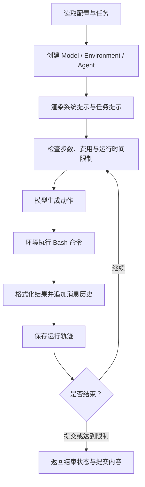
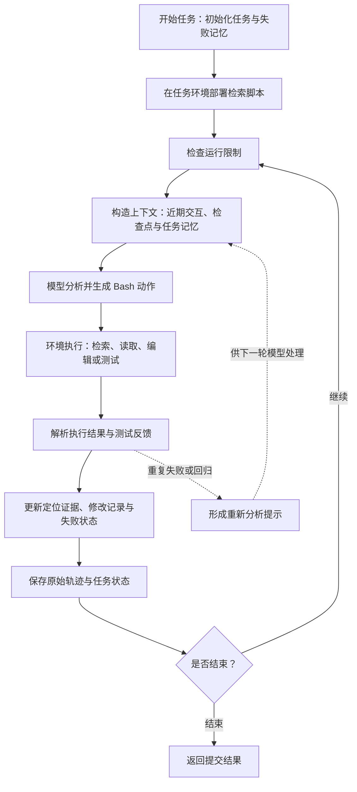

# SWE-Compass

**面向代码修复的轻量级软件工程 Agent。**

SWE-Compass 从问题描述出发，检索相关代码、执行命令、修改文件，再依据测试结果继续修复。它将任务记忆、代码定位和失败反馈接入同一个执行循环，并记录模型决策、工具调用与验证证据，方便复盘一次修复是如何完成的。

Compass 意为「指南针」：用仓库证据确定位置，用任务记忆保持方向，用测试反馈校正下一步行动。

## 核心能力

| 能力 | 解决的问题 | 实现方式 |
| --- | --- | --- |
| 任务记忆与上下文管理 | 历史越来越长，关键约束和测试结果容易淹没在日志中 | 维护结构化任务状态，清理重复旧结果，按窗口预算生成可追溯检查点 |
| 仓库级代码检索 | 仅凭问题描述难以快速定位相关文件与符号 | 结合路径、关键词、堆栈、测试引用与 Python AST，返回带行号和命中原因的代码片段 |
| 反馈驱动修复 | 重复尝试同一方案，却没有重新审视失败原因 | 提取测试失败证据，跟踪失败变化，在重复失败或回归时提示重新分析 |
| 运行观测与独立评测 | 只能看到最终答复，难以判断执行过程与修复结果 | 保存轨迹与调用链，展示资源用量、诊断和运行对比，并单独执行验证命令 |

项目基于 [mini-SWE-agent](https://github.com/SWE-agent/mini-swe-agent) 构建，沿用它清晰的 Agent / Model / Environment 分工。代码检索仍通过 Bash 调用，上下文处理与反馈分析接入原有循环，观测和评测可按需使用。

## 快速开始

需要 **Python 3.10+、Git** 和可用的模型接口。Agent 推荐在 Linux、macOS 或 Windows 的 WSL / Ubuntu 中运行；以下命令使用 Bash。SWE-bench 任务还需要容器环境。

### 安装

```bash
git clone https://github.com/cangnai/swe-compass.git
cd swe-compass
python -m venv .venv
source .venv/bin/activate
python -m pip install -e '.[observability]'
cp mini-api.example.yaml mini-api.yaml
export OPENAI_API_KEY='你的 API Key'
```

在本地 `mini-api.yaml` 中选择模型。示例默认使用 `openai/gpt-4o`；兼容 OpenAI 的服务可设置 `model.model_kwargs.api_base`，Responses API 可选择 `model_class: litellm_response`。API Key 通过环境变量或 `mini-extra config` 管理，本地配置不会提交到仓库。

### 运行修复任务

在安装目录执行下面的命令，将目标路径替换为需要处理的代码仓库：

```bash
mini -c mini.yaml -c compass.yaml -c mini-api.yaml \
  -c environment.cwd=/absolute/path/to/target-repo \
  -t '请复现并修复这个项目的问题，运行相关测试，并说明修改内容和验证结果。' \
  -o runs/compass.traj.json
```

`compass.yaml` 启用任务记忆、仓库检索和测试反馈，默认最多调用模型 100 步、费用上限 3 美元。此模式自动执行模型生成的命令。费用与步数在下一次请求前检查，单次请求仍可能使费用超过设定值。

需要逐条确认命令时，使用交互模式：

```bash
mini -c mini.yaml -c mini-api.yaml \
  -c environment.cwd=/absolute/path/to/target-repo \
  -t '请检查项目并修复问题。' \
  -o runs/interactive.traj.json --exit-immediately
```

交互模式使用 `InteractiveAgent`，不包含 Compass 配置启用的三项处理。省略 `-t` 可在终端输入任务；`--exit-immediately` 控制提交后是否继续询问新任务。未设置 `environment.cwd` 时，任务在启动命令所在的目录执行。

为保留现有调用方式，命令行入口仍使用 `mini`、`mini-extra`、`mini-observe`，Python 导入路径仍为 `minisweagent`。

## 执行流程

### 基础循环：模型决策、命令执行、结果反馈

原始 mini-SWE-agent 的运行入口选择 Model、Environment 和 Agent，随后调用 `agent.run(task)`。每一步由模型生成动作、环境执行命令，再把结果作为 Observation 加入消息历史。



在实现中，`step()` 依次调用 `query()` 和 `execute_actions()`。模型适配器负责消息协议与动作解析，环境负责执行和识别提交标记。轨迹在每轮保存，意外异常记录后继续抛出。每条命令使用独立子进程，上一条命令中的 `cd` 不会改变下一条命令的工作目录。

### Compass 循环：让记忆、检索与反馈参与下一步决策

SWE-Compass 在基础循环的三个位置加入处理：任务开始时初始化状态与检索工具，模型请求前构造上下文，命令执行后整理测试反馈。三部分共享当前任务的状态，仍由同一个 Agent 循环推进修复。



检索由模型按需调用；反馈分析不会额外启动模型或自动测试循环。任务结束后，还可以通过观测工具查看过程，并使用独立验证命令判断修复结果。

## 模块设计

### 上下文管理：保留任务状态，控制历史体积

`ContextManager` 维护当前任务的约束、文件与符号证据、修改意图、测试结果、假设和下一步。模型可见历史与原始轨迹分开：重复旧结果可以被清理，较早的完整交互可以转为摘录检查点，完整消息仍保留用于追溯。

系统提示、原始任务、近期交互和未完成工具调用受到保护。检查点采用确定性摘录，不额外调用模型；窗口预算使用保守估算，与实际 API Token 用量分别记录。

[阅读上下文管理设计 →](docs/context_engineering.md)

### 仓库检索：从问题线索定位到代码片段

`RepoSearch` 在任务实际运行的环境中部署标准库脚本。它组合路径、模块名、关键词、测试引用和 traceback 信号，对候选文件排序；Python 文件进一步使用 AST 定位类、函数和方法，其他语言或解析失败时使用文本定位。

结果附带路径、行号、符号与命中原因。每次检索读取当前工作树，修改后可以重新查询。候选证据进入任务记忆，供后续阅读和验证使用。

[阅读仓库检索设计 →](docs/repository_retrieval.md)

### 测试反馈：区分失败事实与修复假设

`FeedbackManager` 在命令执行后分析真实输出，区分普通非零退出、测试失败、明确通过、不确定结果和执行器异常。失败记忆保留测试范围、异常特征和来源，同一范围的后续结果用于更新状态。

连续同组失败、通过后回归，或结果与成功声明冲突时，系统提示模型重新检查假设。不同范围的测试通过不会清除无关失败，模型对根因的判断仍需要证据验证。

[阅读反馈驱动修复设计 →](docs/feedback_guided_repair.md)

### 观测与评测：从执行记录到可核查结果

观测层通过包装器采集真实模型和工具调用，使用 SQLite 保存任务、运行、调用、事件和评测记录。看板提供四个视角：

| 页面 | 查看内容 |
| --- | --- |
| 执行轨迹 | 每一步的模型决策、Action、Observation 与关联证据 |
| 运行监控 | 调用链、耗时、已记录 Token 与费用 |
| 失败分析 | 执行异常、人工干预与疑似无进展行为的规则诊断 |
| 任务与对比 | 任务运行、独立验证、配置差异与多次运行对比 |

**Agent 提交结束与测试通过分别记录。** `Submitted` 表示执行流程已经提交；独立验证返回 `passed`、`failed`、`not_evaluated` 或 `evaluation_error`。缺失的 Token、费用与耗时保持未知。

[阅读观测与评测使用说明 →](docs/observability_usage.md)

## 查看一次运行

导入前面保存的轨迹并打开看板：

```bash
mini-observe import runs/compass.traj.json --db .mini-observe/traces.db
mini-observe serve --db .mini-observe/traces.db
```

浏览器访问 <http://127.0.0.1:8501>。历史导入展示原文件已有的信息；需要采集运行时调用链时，可登记任务并使用 `mini-observe run` 启动，具体操作见[使用说明](docs/observability_usage.md)。

也可以先体验无需 API 的离线演示：

```bash
python -m pip install pytest
mini-observe demo
mini-observe serve --db .mini-observe/demo/traces.db
```

演示使用预编写的模型响应执行真实命令、修改与测试，展示从执行到评测的完整链路，不作为在线模型能力实验。

## 配置

`compass.yaml` 是叠加配置，需要与完整基础配置一起使用。多个 `-c` 按顺序递归合并，后面的同名值覆盖前面的值；显式传入 `-c` 后，默认配置不会自动补上。`-m` 等专用参数还会覆盖配置文件中的对应字段。

| 配置项 | 默认值 | 用途 |
| --- | --- | --- |
| `agent.step_limit` | `100` | 模型调用步数上限 |
| `agent.cost_limit` | `3` | 费用上限，单位美元；`0` 为不限制 |
| `agent.context.context_window` | `null` | 优先使用模型本地元数据，未知时回退到 32768 |
| `agent.context.reserved_output_tokens` | `4096` | 为模型输出预留空间 |
| `agent.context.compaction_threshold` | `0.85` | 达到可用输入预算比例时尝试压缩 |
| `agent.context.keep_recent_turns` | `4` | 保护最近完整交互 |
| `agent.retrieval.enabled` | `true` | 部署仓库检索工具 |
| `agent.retrieval.top_k` | `5` | 每次返回的检索片段数 |
| `agent.feedback.enabled` | `true` | 分析测试反馈并维护失败记忆 |
| `agent.feedback.repeat_failure_threshold` | `3` | 连续同组失败触发重新分析的阈值 |

例如，为较大的上下文窗口指定预算：

```bash
mini -c mini.yaml -c compass.yaml -c mini-api.yaml \
  -c agent.context.context_window=128000 \
  -c environment.cwd=/absolute/path/to/target-repo \
  -t '请定位并修复问题。' -o runs/compass.traj.json
```

可以分别设置 `agent.retrieval.enabled=false` 或 `agent.feedback.enabled=false`，观察模块对同一任务的影响。其余参数与处理边界见模块文档。

## SWE-bench 与实验

准备好容器环境后，可使用原 benchmark 入口运行 Compass 配置：

```bash
mini-extra swebench --subset verified --split test \
  -c swebench.yaml -c compass.yaml -c mini-api.yaml \
  -o runs/swebench-compass
```

预测文件、进度显示和轨迹格式沿用原入口。比较不同配置时，应固定任务、初始版本和评测方式，并记录模型、预算与运行结果；项目的实际修复能力需要通过对照实验评估。

仓库还提供固定种子的分层抽样与嵌套扩样脚本。自行准备 `dataset/swebench_verified_500.jsonl`，包含脚本要求的 `instance_id`、`repo`、`difficulty`、`patch`、`test_patch` 等字段后，依次执行：

```bash
python scripts/sample_verified50.py
python scripts/sample_verified100.py
```

数据、抽样结果、ID 清单和报告在本地生成，不提交到仓库。缺少数据时，相关集成测试跳过，抽样算法测试仍可运行。参考答案字段用于抽样完整性检查，不应作为 Agent 的问题输入。

## 项目结构

```text
src/minisweagent/
├── agents/          # 基础循环、交互模式与任务处理
├── environments/    # 本地、Docker 等执行环境
├── models/          # 模型接口、消息协议与动作解析
├── optimization/    # 上下文、任务状态、检索与测试反馈
├── observability/   # 采集、存储、诊断、评测与看板
├── config/          # 基础配置与 compass.yaml
└── run/             # 任务、基准运行与观测入口
scripts/             # 抽样脚本与 Jinja 模板
tests/               # 核心流程、模块与集成验证
docs/                # 使用说明与设计细节
plan/                # 实施计划
```

## 开发与验证

```bash
python -m pip install -e '.[dev,observability]'
python -m pytest tests/agents tests/observability tests/models/test_cache_control.py -q
python -m pytest tests/test_verified50_sampling.py tests/test_verified100_sampling.py -q
```

容器测试依赖对应运行环境和镜像，真实 API 测试需要显式启用。命令与模型接口的通用用法可参考 [mini-SWE-agent 官方文档](https://mini-swe-agent.com/latest/)。

本地 API 配置、环境变量文件、运行轨迹、数据库、工作区、数据集和临时报告均通过 `.gitignore` 排除。上游已有的 `tests/test_data` 轨迹作为测试夹具保留。

## 致谢与许可

SWE-Compass 基于 [SWE-agent/mini-swe-agent](https://github.com/SWE-agent/mini-swe-agent)，感谢原作者提供简洁、可扩展的执行框架。本仓库保留原作者信息与 [MIT 许可证](LICENSE.md)。

相关论文：[SWE-agent: Agent-Computer Interfaces Enable Automated Software Engineering](https://arxiv.org/abs/2405.15793)。
