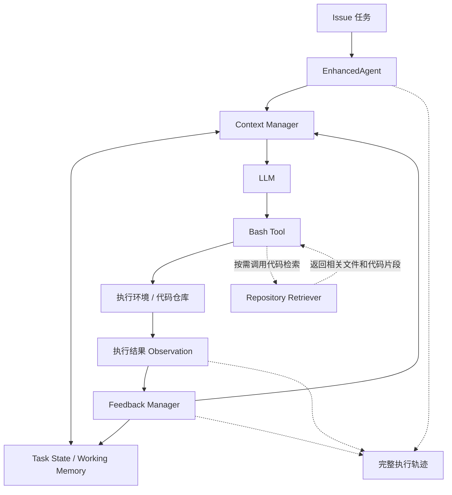

# Enhanced mini-SWE-agent：总体改进规划

> 本文仅确定整体技术路线与系统架构。三个改进模块的实现细节，将分别在独立 Markdown 文档中讨论和确定。

## 一、项目定位

以 **mini-SWE-agent** 为基础，保留其**单 Agent、LLM + Bash Tool、执行环境与循环交互**的轻量架构，围绕真实 Coding Agent 修复 Issue 的过程，完成三个相互协作的能力增强：

1. **Context Engineering（上下文工程）**：让 Agent 在长任务中更合理地管理历史信息，不因冗余上下文或压缩丢失关键进度。
2. **Repository-Level Retrieval（仓库级代码检索）**：让 Agent 更高效地定位与 Issue 相关的文件、函数和代码片段。
3. **Feedback-Guided Repair（反馈驱动修复）**：让 Agent 更有效地利用测试失败信息，避免无效重试和重复错误。

目标是形成一个**功能完整、架构仍然轻量**的增强版 Coding Agent，而不是另起一套复杂的智能体框架。

## 二、整体架构



**核心流程不变**：模型决定操作 → Bash 在目标仓库执行 → 得到 Observation → 模型继续决策，直到完成任务。新增模块只负责增强模型**获取信息、保留信息、利用反馈**的能力。

**信息分层**：完整执行轨迹用于回溯，不因上下文处理而丢失；每轮发送给模型的 Context 可以清理、压缩和重组；Task State 单独保存当前 Issue 的关键事实与进度。

## 三、三个改进方向

### 1. Context Engineering

**现有问题**：历史消息随交互不断增长，较早的搜索输出、旧代码和测试日志可能反复占用上下文；直接截断又可能丢失定位结果和修复进度。

**计划方案**：
- **History Elision / Tool-result Clearing**：根据工具结果是否过时、重复或被新结果替代，清理低价值历史，而不是简单删除所有旧消息。
- **Context Compaction**：当*单次模型请求*接近其实际上下文窗口容量时，压缩早期历史并保留关键任务信息。
- **Structured Task Memory**：维护当前 Issue 的定位结论、关键文件、已做修改、测试状态、未解决的问题和下一步计划；随关键事件更新。

**重要约束**：不以一个 Issue 的**累计 Token 或累计 Cost**作为压缩触发条件，也不为了省钱限制 Agent 的任务总消耗。压缩主要用于上下文质量维护和模型窗口保护。

**集成位置**：在 `DefaultAgent.query()` 调用模型之前构造模型可见消息；完整原始轨迹与模型上下文分离。参考 [SWE-agent 的 History Processors](https://github.com/SWE-agent/SWE-agent/blob/main/sweagent/agent/history_processors.py)。

### 2. Repository-Level Retrieval

**现有问题**：Agent 依靠 Bash 自行试探关键词、路径和文件内容，容易重复搜索、阅读大量无关代码，定位真正需要修改的区域较慢。

**计划方案**：
- **File-Level Localization**：结合 Issue、异常信息、文件路径和 `ripgrep`，定位候选文件。
- **Symbol / Function-Level Localization**：利用 AST 或符号索引定位类、函数、相关行号。
- **Hybrid Ranking & Snippet Retrieval**：综合路径、关键词和符号匹配，返回有来源位置的相关代码片段，供模型进一步判断。

**集成位置**：保持原有 Bash Tool，不必改造成多工具 Agent；在目标代码仓库所在的执行环境中提供可调用的检索能力。模型可按需使用普通 Bash 或增强检索，不被检索结果强制限制。参考 [Aider Repo Map](https://github.com/Aider-AI/aider/blob/main/aider/repomap.py) 与 [Agentless](https://github.com/OpenAutoCoder/Agentless)。

### 3. Feedback-Guided Repair

**现有问题**：虽然原版会把命令执行结果反馈给模型，但缺少针对测试失败的结构化总结和重复失败识别；模型可能在同一错误上反复尝试。

**计划方案**：
- **Test Feedback Parsing**：识别测试命令及其结果，抽取失败测试、异常类型、关键断言和相关报错位置。
- **Failure Memory**：将重要测试失败与已尝试的修复关联，识别持续重复或新出现的失败。
- **Event-Triggered Reflection**：当连续失败、假设与测试矛盾或明显无进展时，向下一轮模型提供针对性的重新分析提示；不要求每轮额外调用一次反思模型。

**集成位置**：在 `execute_actions()` 获得环境返回结果后处理 Observation，并与 Task State / Context Manager 协同。区分**正常命令非零返回、代码测试失败、Agent/环境系统异常**；只使用任务执行过程中可获得的反馈。参考 [Reflexion](https://github.com/noahshinn/reflexion)、[Agentless](https://github.com/OpenAutoCoder/Agentless)。

## 四、工程组织与模块关系

建议保留原版 `DefaultAgent`，新增 `EnhancedAgent` 组织三项能力，而不是将所有逻辑直接塞进 `default.py`。

```text
src/minisweagent/
├── agents/
│   ├── default.py                 # 保持原版核心逻辑
│   └── enhanced.py                # 组织增强执行循环
├── optimization/
│   ├── context_manager.py         # 历史清理与上下文压缩
│   ├── task_state.py              # 当前 Issue 工作记忆
│   ├── repo_retriever.py          # 仓库级代码定位
│   └── feedback_manager.py        # 测试反馈与反思触发
├── models/                       # 尽量复用原有 LLM 接口
└── environments/                 # 尽量复用原有执行接口
```

三项能力的协作关系：**检索模块**提供更相关的代码；**上下文模块**保留对修复有用的信息；**反馈模块**根据执行与测试结果更新任务状态，推动下一次定位或修复。三个模块逻辑独立，但通过 `EnhancedAgent` 与 Task State 协同工作。

## 五、后续独立设计文档

总体规划确定后，分别制定完整实现方案，再交给 Codex 编码：

1. `01_context_engineering.md`：上下文清理、压缩策略、Task Memory、模型消息处理方式。
2. `02_repository_retrieval.md`：代码索引、分层检索、排序、Bash/执行环境集成。
3. `03_feedback_guided_repair.md`：测试反馈解析、失败状态、反思触发、Agent 循环集成。

**本文件只规定“改什么、为什么改、模块如何协作”；具体算法选择、参数、接口和代码细节由对应的三份文档展开。**
